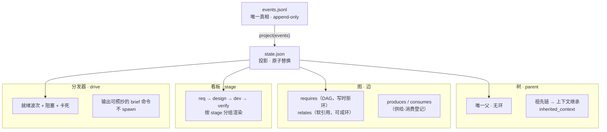
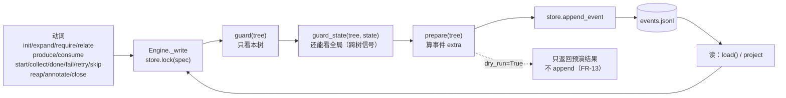
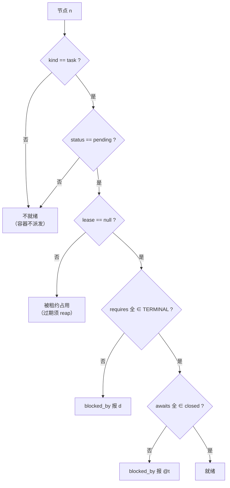
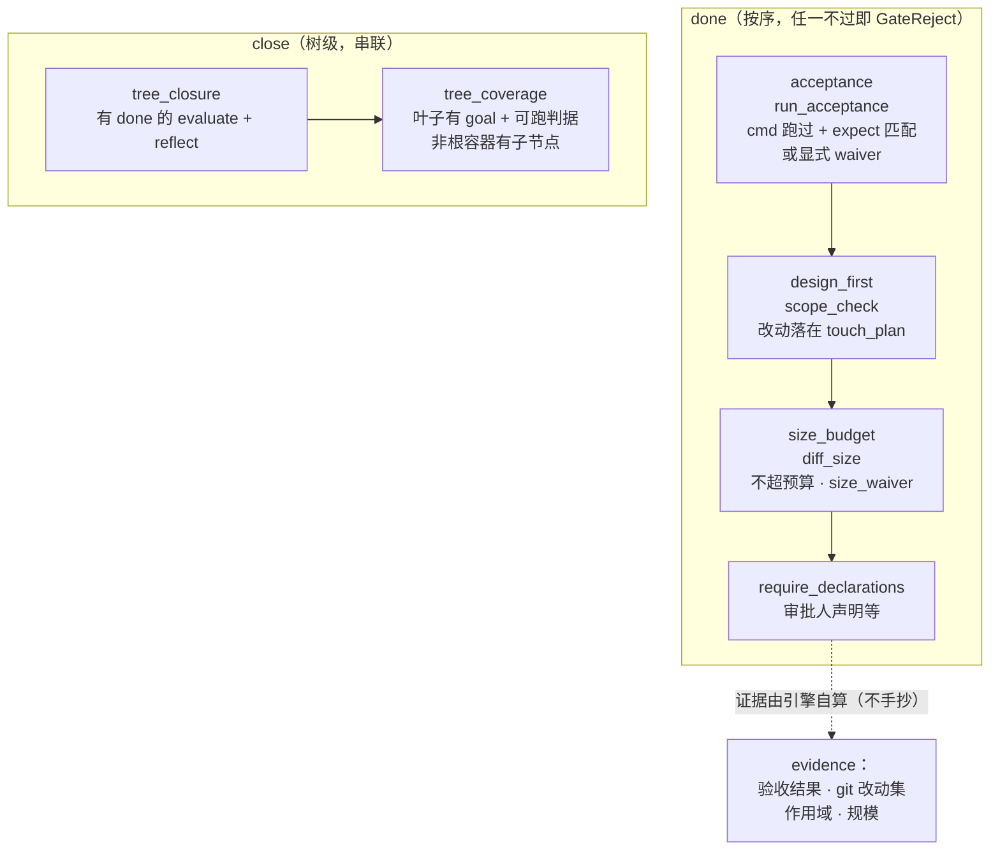
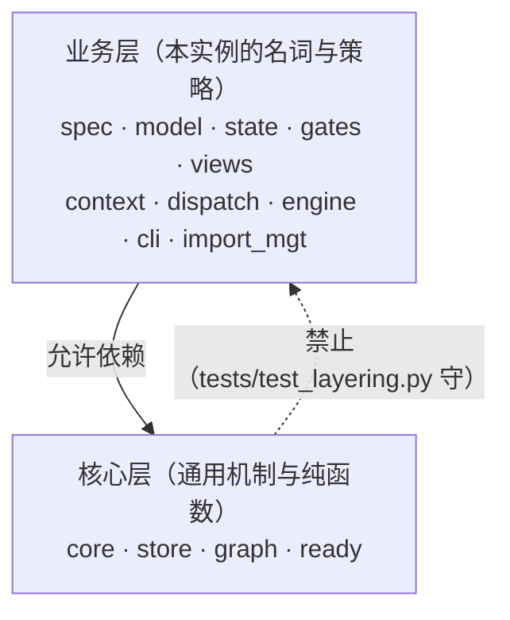
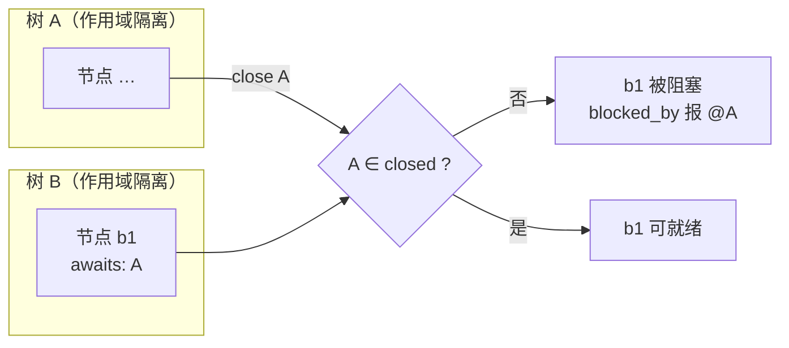
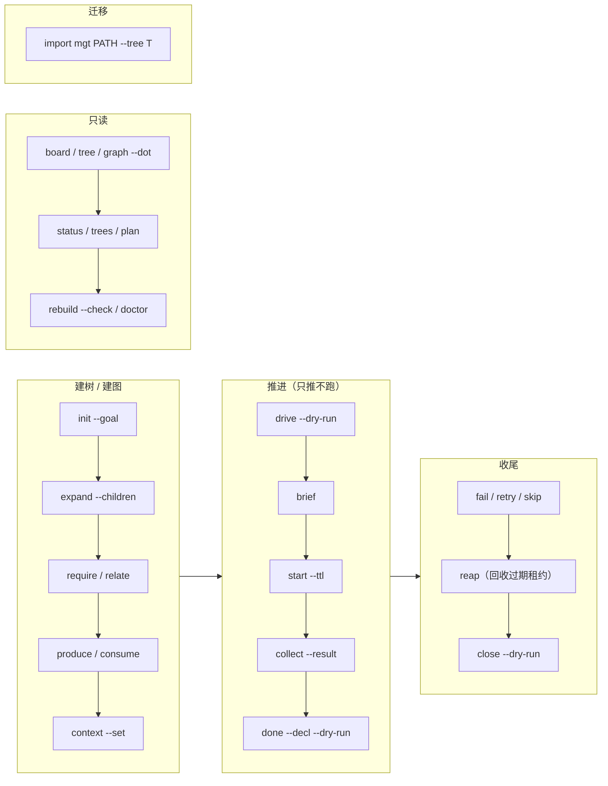

# disflow 架构图

> 本文件用 **Mermaid**（纯文本，GitHub 原生渲染成图，零依赖）。
> 图都按**实现**画（函数名/字段名取自 `disflow/*.py`），不是愿景草图。

## 0. 一张纸概览（纯文本，便于终端阅读）

```text
                     ┌──────────────────────────────┐
   动词（写）         │  events.jsonl                │  ← 唯一真相
   init/expand/       │  tree.init · node.expand …    │     append-only
   require/start/     └──────────────┬───────────────┘
   done/close/reap                   │ project(events)
                                     ▼
                     ┌──────────────────────────────┐
                     │  state.json                  │  ← 投影（原子替换）
                     └──────────────┬───────────────┘
                                    │ 只读
        ┌───────────────┬───────────┼───────────┬────────────────┐
        ▼               ▼           ▼           ▼                ▼
   树 parent        图 requires   看板 stage   分发器 drive     自检 doctor
   上下文继承       调度与引用     阶段列(挂在树上)  只推不跑     投影/悬空/租约
```

## 1. 四个面各管什么（核心判断）

**树管上下文继承；图管调度与引用；阶段列与列策略挂在树上（[ADR 0015](decisions/0015-板非顶层实体.md)：板**不是**顶层实体，0005 结构层已降级）；分发器只推不跑。** 四者永不混用。



> **反例（mgt 的病根）**：把层级也表达成图边（`contains`）、把就绪存成字段（双状态机）。
> disflow 的做法：`contains` 删除（= `parent`）、`ready` **派生不存**。

## 2. 数据流：写只有一条路径

所有写操作走**同一个写点** `Engine._write`：**取锁 → 读投影 → 校验（guard）→ append 事件**。



**不变量**：投影永不被直接改写；`rebuild --check` 能从事件重算并逐字节比对。

## 3. 就绪判据 `ready(n)`（唯一函数，纯函数）

**分发器与 worker 共用同一份**；同输入必同输出（FR-11）。**不看时钟**——租约过期靠显式 `reap`。



`TERMINAL = (done, skipped)` —— **前置被 `skip` 掉不再阻塞后继**（「显式放弃」≠「还没做」）。

## 4. 门：唯一的两处「必须过」



**逃生口**（都要**非空理由**，且记入证据，不是静默放行）：

| 门 | 逃生口 |
| --- | --- |
| `acceptance` | `acceptance.waiver = "<理由>"` |
| `size_budget` | `done --decl '{"size_waiver":"<理由>"}'` |
| `tree_closure` | `root.context.closure = "not_applicable: <理由>"` |
| `tree_coverage` | `root.context.coverage = "not_applicable: <理由>"` |

## 5. 分层与依赖方向（NFR-2：核心零业务词）



`core.py` 持有机制词汇：`KINDS` / `STORED_STATUS` / `TERMINAL`（`vocab.py` 只做再导出）。
判据是**可执行断言**：扫核心四文件的业务词针脚（单词边界正则）+ 断言核心未 import 业务模块。

## 6. 多块板 = 多棵树（作用域隔离）

跨树依赖**不是图边**，降级为**显式完成信号**——把多棵树连成一张图会引入分布式共识。



`requires` **不许跨树**（写入即拒）；跨树只能用 `awaits`（粗粒度、显式）。

## 7. 动词地图



## 8. 文件地图

```text
disflow/
  core.py        # 机制词汇（核心层，零业务词）
  store.py       # L0 事件流 + 原子投影（vendored 自 fat3 flowcore）
  state.py       # 事件 → 投影 reducer
  model.py       # 节点模型 / 树语义
  graph.py       # requires/relates + 环检测
  ready.py       # ready()（纯函数，不看时钟）
  context.py     # brief() / 祖先链上下文
  gates.py       # 五道门 + 证据采集
  dispatch.py    # drive/plan + 波次打包（写面，业务）
  views.py       # board/tree/graph（同源视图）
  import_mgt.py  # mgt 导入器
  engine.py      # 动词面（唯一写点 _write）
  cli.py         # 命令装配
```

**四个面 ↔ 模块**：树 = `model` · 图 = `graph` · 看板 = `views` · 分发器 = `dispatch`/`ready`。

## 9. 如何验证本文件的图真能渲染

Mermaid 是**手写的**，编辑器里可能看不出语法错。本文件的 7 张图已**真渲染验证**
（2026-10-10，7/7 OK，且断言每张 SVG 含其关键标签、无 `Syntax error`、无 `error-icon` 元素）：

```bash
# mermaid-cli 靠 puppeteer 起浏览器；**必须先指路**，否则报 ChromeLauncher.launch 失败
# （那不是语法错，是本轮什么都没验证到）
export PUPPETEER_EXECUTABLE_PATH="/Applications/Google Chrome.app/Contents/MacOS/Google Chrome"

# 从本文件抽出所有 mermaid 块逐个渲染
python3 - <<'PY'
import re, pathlib
blocks = re.findall(r"```mermaid\n(.*?)```",
                    pathlib.Path("docs/architecture.md").read_text(encoding="utf-8"), re.S)
for i, b in enumerate(blocks, 1):
    pathlib.Path(f"/tmp/d{i}.mmd").write_text(b, encoding="utf-8")
PY
for f in /tmp/d*.mmd; do npx -y @mermaid-js/mermaid-cli -i "$f" -o "${f%.mmd}.svg"; done
```

GitHub 页面会原生渲染这些图，**不需要**提交 SVG 产物。
若确实要离线图片，用上面的命令生成（约 1 分钟/张），但请注意：**产物会与源漂移**，
所以权威源永远是本文件的 ```mermaid 块，而不是任何 `.svg`。
